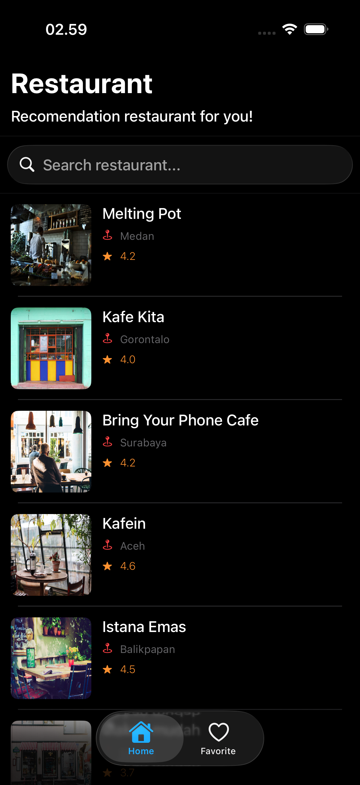
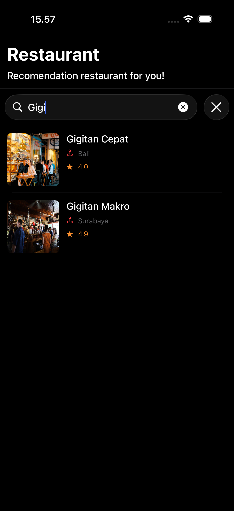
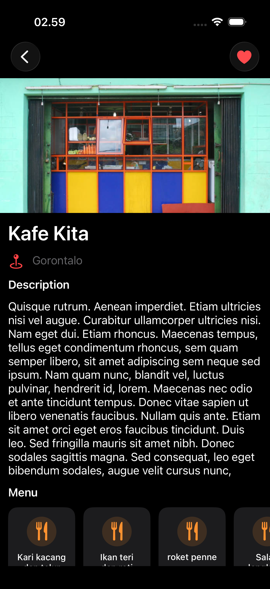
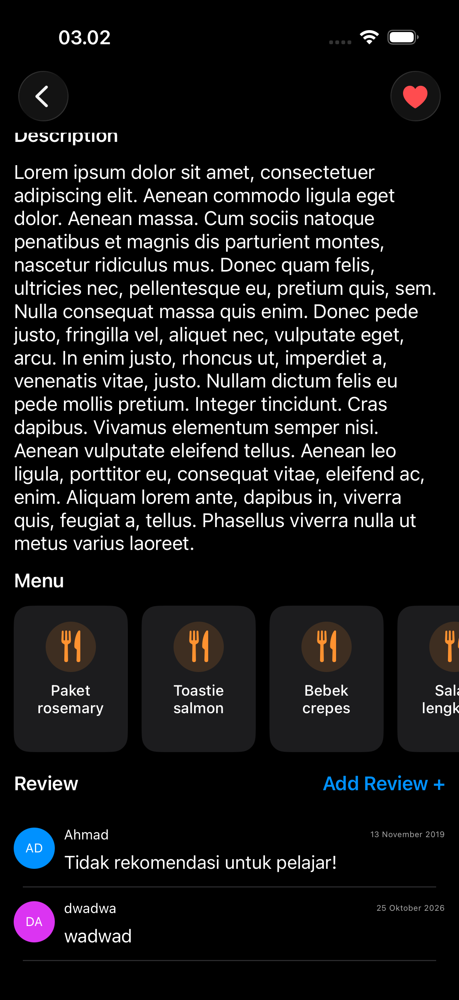

# RestaurantApp

An iOS app that lists restaurants and shows their details, built with UIKit and the **VIPER** architecture. Data comes from the [Dicoding Restaurant API](https://restaurant-api.dicoding.dev).

## Features

- Restaurant list with images and an empty state view
- Restaurant detail screen
- Remote image loading and caching
- Unit tests for the interactors, presenters, loaders and HTTP client

## Demo

| Restaurant List | Search | Detail | Menu and Reviews |
| :---: | :---: | :---: | :---: |
|  |  |  |  |

## Tech Stack

- Swift, UIKit (XIB-based views)
- [RxSwift](https://github.com/ReactiveX/RxSwift)
- [Kingfisher](https://github.com/onevcat/Kingfisher)
- XCTest
- Swift Package Manager

## Architecture

Each feature module follows VIPER (View, Interactor, Presenter, Entity/Model, Router):

```
RestaurantApp/
├── App/                    # AppDelegate, SceneDelegate, launch screen
├── Core/
│   ├── Infrastructure/     # HTTPClient protocol, URLSessionHTTPClient
│   └── Services/           # Remote list/detail loaders, NetworkError
└── Modules/
    ├── RestaurantList/     # Protocols, Interactor, Presenter, Router, Views
    └── RestaurantDetail/   # Protocols, Interactor, Presenter, Router, View

RestaurantAppTests/         # Unit tests mirroring the source layout
```

The networking layer sits behind the `HTTPClient` protocol, so loaders and interactors can be tested with stubs.

## Requirements

- Xcode (a version that supports the project's iOS deployment target, currently 26.5)
- An internet connection (API and image access)

## Getting Started

1. Clone the repository.
2. Open `RestaurantApp.xcodeproj` in Xcode.
3. Wait for Swift Package Manager to resolve dependencies.
4. Select the `RestaurantApp` scheme and a simulator.
5. Press `Cmd + R` to run.

## Running Tests

In Xcode, press `Cmd + U`, or from the terminal:

```bash
xcodebuild test \
  -project RestaurantApp.xcodeproj \
  -scheme RestaurantApp \
  -destination 'platform=iOS Simulator,name=iPhone 16'
```

Replace the simulator name with one available on your machine.

## Test Spy Pattern

The tests use **test spies** to check an object's behavior without real collaborators such as the network or a live UI.

A spy is a hand-written test double that conforms to the same protocol as the real dependency. It does two jobs:

1. **Records interactions.** It captures calls, arguments and call order (for example, the requested URLs or the messages a view received). Tests then assert on what happened.
2. **Returns canned results.** It lets a test control success or failure on demand, with no real I/O.

Because every dependency sits behind a protocol, the system under test (SUT) can be given a spy instead of the real implementation.

### Spies in this project

| Spy | Replaces | Used to test |
| --- | --- | --- |
| `HTTPClientSpy` ([XCTestHelpers.swift](RestaurantAppTests/XCTestHelpers.swift)) | `HTTPClient` | `RemoteRestaurantListLoader`, `RemoteRestaurantDetailLoader` |
| `RestaurantListLoaderSpy` | `RestaurantListLoader` | `RestaurantListInteractor` |
| `RestaurantDetailLoaderSpy` | `RestaurantDetailLoader` | `RestaurantDetailInteractor` |
| `ViewSpy` | View, Interactor and Router protocols | `RestaurantListPresenter`, `RestaurantDetailPresenter` |

The HTTP client tests use a `URLProtocolStub` instead. It stubs responses at the `URLSession` level.

### Typical test shape

Each test file has a `makeSUT()` helper that builds the SUT together with its spy:

```swift
let (sut, spy) = makeSUT()

spy.interactorStub = .just([restaurant])   // 1. arrange: control the result
sut.viewDidLoad()                          // 2. act: exercise the SUT

// 3. assert: check what the spy recorded
XCTAssertEqual(spy.messages, [.showLoading, .display([restaurant]), .hideLoading])
```

### Why spies

- **Fast and deterministic:** there are no network calls or UI rendering.
- **Isolated:** each VIPER layer is tested on its own.
- **Verifies collaboration:** you can assert how a component talks to its dependencies, not only what it returns.

## API

Base URL: `https://restaurant-api.dicoding.dev`

Images are served from `https://restaurant-api.dicoding.dev/images/medium/<pictureId>`.
